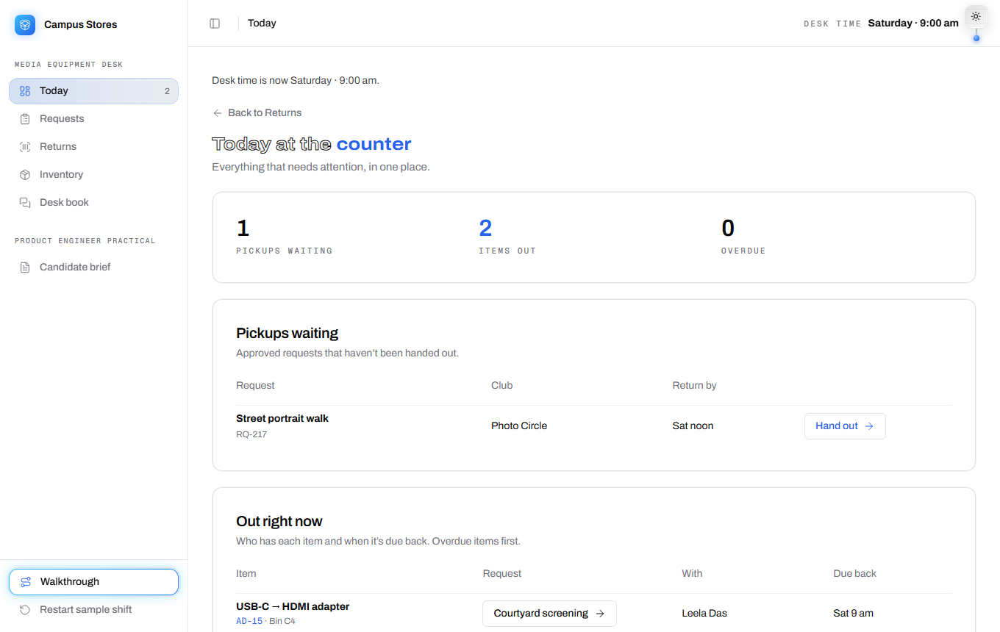
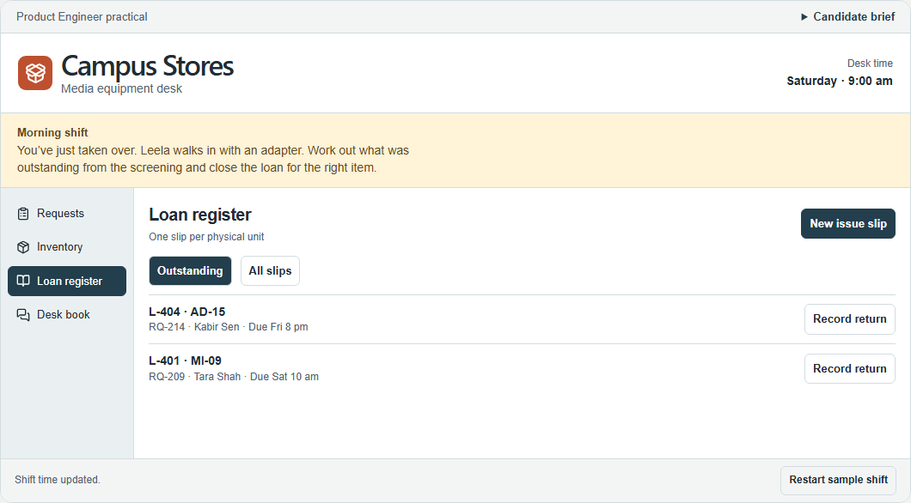
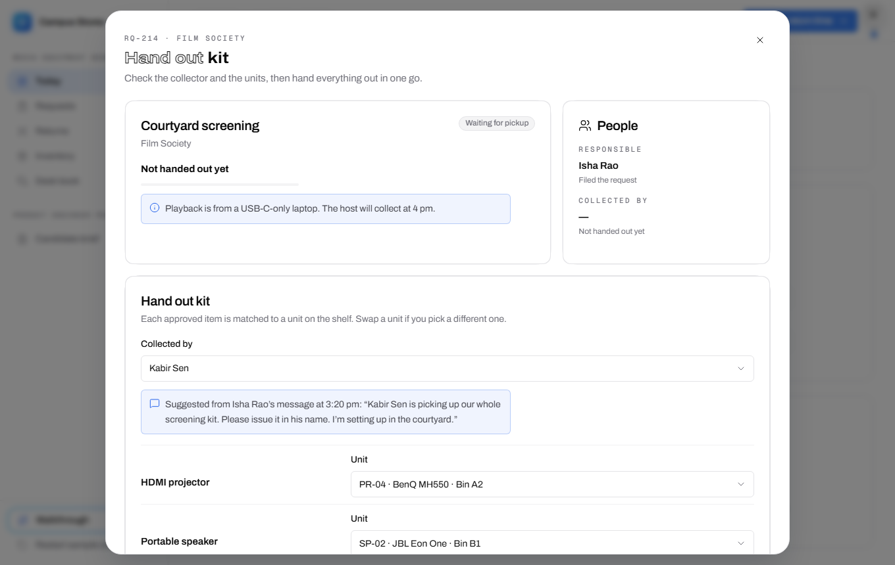
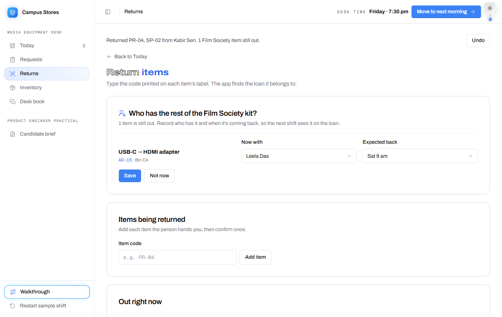
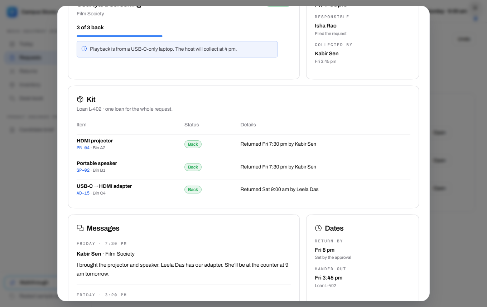
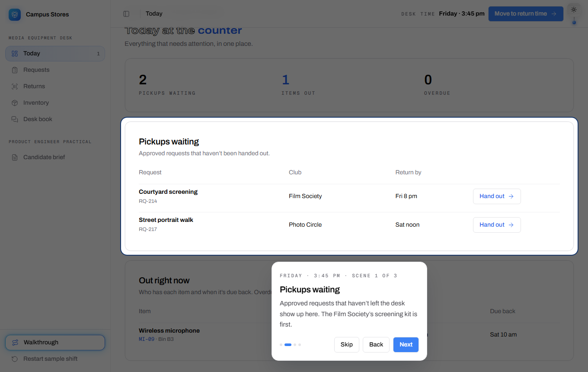

<div align="center">

# 📦 Campus Stores

### Would I keep this product? **Yes, with one change to how it models a loan.**

The desk already stops the wrong equipment from leaving.<br>
It breaks at the handover, so I rebuilt the loan so **the app, not a note, tells the next shift who has what.**

<br>



<sub>Saturday 9 am in the redesign: the morning shift sees the adapter is with Leela, due back now. No note to read.</sub>

</div>

<br>

## ⚡ At a glance

| | Before | After |
|---|:---:|:---:|
| **Hand out a 3-item kit** | 18 clicks and selections | **2 clicks** |
| **Partial-return handover** | Free-text note in the Desk book | **Recorded on the item by the app** |
| **Who is responsible** | Only "Collected by: Kabir" | **Isha (requester) · Kabir (collected) · Leela (has it now)** |
| **Returning the wrong adapter** | Easy: pick a row from a list | **Caught: return by the code on the label** |
| **Approved return time** | Re-typed, could be extended silently | **Taken from the approval** |
| **Undo a mistaken return** | Impossible (restart the shift) | **One click** |
| **Late items** | Never flagged | **Marked Overdue** |

<br>

## ✅ 1 · What the product handles well

> [!TIP]
> **The moment: issuing the Film Society kit at Friday 3:45 pm.** The app refused to let the wrong things out of the door.

- **It blocks equipment the club wasn't approved for.** I picked the digital camera (CA-03) for the Film Society by mistake, and it was rejected: *"This equipment type is outside the approved request."*
- **It enforces the approved quantity.** A second speaker on the same request is refused.
- **Broken stock never reaches the counter.** Projector PR-06 is in the workshop, so it isn't offered. The only projector I could issue was the working PR-04.

The worker doesn't have to remember the approval rules: the product enforces them at the moment of hand-over. **I kept all three checks.**

**Also worth keeping:** every physical unit is tracked separately (which is what makes a partial return possible), the register opens on what's outstanding, confirmations are specific (*"Issued AD-15 to Kabir Sen on slip L-404"*), and it works on a phone.

<br>

## 🔧 2 · The moment I would change

> [!WARNING]
> **The moment: Friday 7:30 pm, the kit comes back in pieces.** Kabir returned the projector and speaker; Leela had the adapter and would bring it at 9 am. The app had nowhere to record that, so I had to type a note in the Desk book for the morning shift.

After that return, the records were wrong and nothing said so:

- the adapter was with **Leela**, but the slip still said **Kabir**;
- it was due **Saturday 9 am**, but the slip still said **Fri 8 pm**, and nothing ever flagged it as late;
- no screen said *"Film Society: 2 of 3 back"*.

The new worker on Saturday had to read my note, cross-check a register that only says *"L-404 · AD-15"*, and decode the code in Inventory. With **two adapters in the same bin (C4)**, closing the wrong one was easy.

**The handover depended on someone writing prose correctly at the end of a shift. It should come from the data.**

<table>
<tr>
<th width="50%">Before: Saturday morning</th>
<th width="50%">After: Saturday morning</th>
</tr>
<tr>
<td></td>
<td></td>
</tr>
<tr>
<td>Slip still says <b>Kabir · Due Fri 8 pm</b>. The truth is in a free-text note on another screen.</td>
<td>The item says <b>with Leela Das · due Sat 9 am</b>, on the first screen the shift sees.</td>
</tr>
</table>

<details>
<summary><b>Other problems I found on the same shift</b> (click to expand)</summary>

<br>

| What I saw | Why it matters |
|---|---|
| Issuing one 3-item kit took **18 clicks and selections**: three separate forms, re-picking the request, person and return time each time | Slow at a counter with a queue and a film starting in 15 minutes |
| The person who **filed** the request (Isha) disappears; only "Collected by: Kabir" is stored | Nobody is accountable once the kit is out |
| "Collected by" lists every student, so the Debate Union's Tara could collect the Film Society kit | No link between a club and who may take its equipment |
| "Return by" isn't filled from the approval, and **Sat noon is accepted** for a kit approved until Fri 8 pm | An approved deadline can be quietly extended |
| The unit list offers everything on the shelf (including the camera); the error only appears after saving | Mistakes are reported instead of prevented |
| Kabir's permission to collect lives in the Desk book; the request itself says *"the host will collect"* | Key information is split across screens |
| **Record return is one click, with no confirmation and no undo**, and doesn't record who brought the item back or when | I closed Tara's microphone by accident; the only fix was restarting the shift |
| Time can be moved on with **nothing issued**; Kabir would leave empty-handed | No warning when the job isn't done |
| Errors appear as small grey text in the bottom bar and vanish on the next click | Easy to miss |

</details>

<br>

## 💡 3 · My change: one loan per request, and the app owns the handover

| | Change | What it fixes |
|:-:|---|---|
| 1 | **One loan per request, with a line per item.** Each item keeps its own status; the request shows *"2 of 3 back"*. | Loose slips, no sense of progress |
| 2 | **Responsible ≠ who has it.** *Responsible: Isha* comes from the request automatically; *Collected by: Kabir* is recorded at pickup; each item records who has it **now**. | Isha disappearing, Leela never recorded |
| 3 | **A partial return asks the question the note used to answer:** *"Who has the rest of the Film Society kit, and when is it coming back?"* | The handover note |
| 4 | **Hand out the whole kit in one step.** Collector suggested from the club's message, a unit pre-matched for each approved item, due time from the approval; only club members and shelf units are offered. | 18 clicks, wrong items, extended deadlines |
| 5 | **Return by item code.** Type the code on the label; the app finds the loan and records who brought it back and when. | Closing the wrong adapter |
| 6 | **Safety nets.** Undo after every change, a warning before moving time on with work unfinished, and **Overdue** flags. | Irreversible clicks, silent lateness |

### The same job, using the prototype

<table>
<tr>
<td width="50%"></td>
<td width="50%"></td>
</tr>
<tr>
<td><b>Friday 3:45 pm: pickup.</b> From <i>Pickups waiting</i>, <b>Hand out</b> opens <i>Hand out kit</i>. Kabir is suggested <i>"from Isha Rao's message at 3:20 pm"</i>, and PR-04, SP-02 and an adapter are matched from the shelf. One confirm: <i>"Handed out 3 items to Kabir Sen on loan L-402. Isha Rao stays responsible."</i> Clearing the adapter would warn: <i>"The kit will leave incomplete. Playback is from a USB-C-only laptop."</i></td>
<td><b>Friday 7:30 pm: partial return.</b> In <b>Returns</b> I type PR-04 and SP-02 and confirm once. The app asks who has the rest; I choose <b>Leela Das, expected Sat 9 am</b>. Moving the clock on before answering triggers a warning that the morning shift won't know who has it.</td>
</tr>
<tr>
<td></td>
<td></td>
</tr>
<tr>
<td><b>Saturday 9:00 am: morning shift.</b> <i>Today → Out right now</i> shows <b>USB-C → HDMI adapter · AD-15 · with Leela Das · due Sat 9 am</b>. No notes to read.</td>
<td><b>Closing the right loan.</b> Leela hands over an adapter; I type <b>AD-15</b> from its label and "Brought back by" already says Leela. <i>"Film Society kit complete: everything is back."</i> Typing AD-12 instead is caught: <i>"AD-12 (USB-C → HDMI adapter) is already on the shelf in bin C4. It isn't on any loan, so check the label."</i></td>
</tr>
</table>

### What I kept

- ✔️ The **approval check**, **quantity check** and **repair units being unavailable**, now applied *before* a mistake can be made.
- ✔️ **Per-unit tracking**, now grouped inside the loan instead of loose slips.
- ✔️ **Outstanding-first views**: *Today* opens on pickups waiting, items out and overdue.
- ✔️ The **Desk book** for club messages, now linked to the request each message is about.
- ✔️ The **three-scene story and time control**, so the exercise plays the same way.

<br>

## 👀 4 · One observation at a real counter

> [!IMPORTANT]
> **Watch the Saturday-morning worker close Leela's adapter, and note whether they open the Desk book (or ask a colleague) before closing the loan.**
>
> If the change works, they go straight from *Out right now* to typing the code and close the right adapter without reading a note. If they still reach for the Desk book, the loan isn't showing enough, and that's what I'd fix next.

<br>

## 🎨 5 · Interface changes



- **Task-based navigation:** Today · Requests · Returns · Inventory · Desk book.
- **Request panels** open from any list, titled for the task (*Hand out kit*, *Out right now*, or the request name), with the clicked item highlighted and the list still visible behind.
- **Status at a glance:** consistent chips (*Waiting for pickup*, *Out*, *Partly back*, *Overdue*, *Complete*) and an "x of y back" progress bar.
- **Item name and code always together:** *USB-C → HDMI adapter · AD-15 · Bin C4*, never a bare code.
- **Errors next to the field** that caused them, in red, until fixed.
- **Spotlight walkthrough** for each scene, replayable from the sidebar, plus a **Back** link on every screen, **light and dark mode**, and phone and desktop layouts.

<br>

## ▶️ Run it

Open `index.html` in a modern browser (works offline), or:

```sh
python3 -m http.server 8000 --bind 127.0.0.1
# then visit http://localhost:8000
```

A walkthrough opens at the start of each scene. **Walkthrough** in the sidebar replays it, and **Restart sample shift** resets the story.

<details>
<summary>Source files</summary>

- `index.html`: page layout, navigation and header
- `app.js`: sample records, loan model, screens and interactions
- `styles.css`: app-specific styles (forms, status chips, panels, walkthrough)
- `docs/screenshots/`: images used in this README
- `third-party/`: bundled icon library and licence notices

</details>
